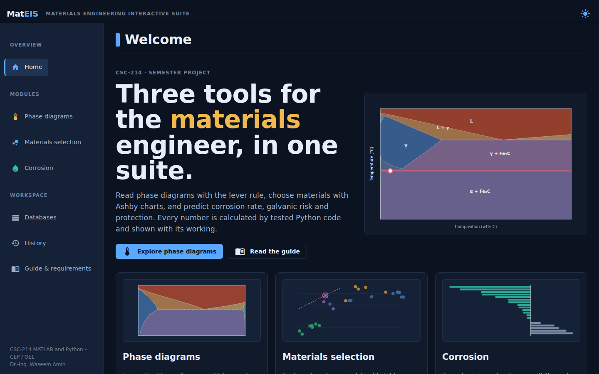
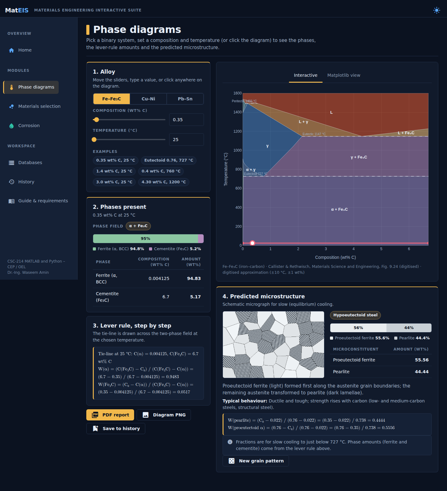
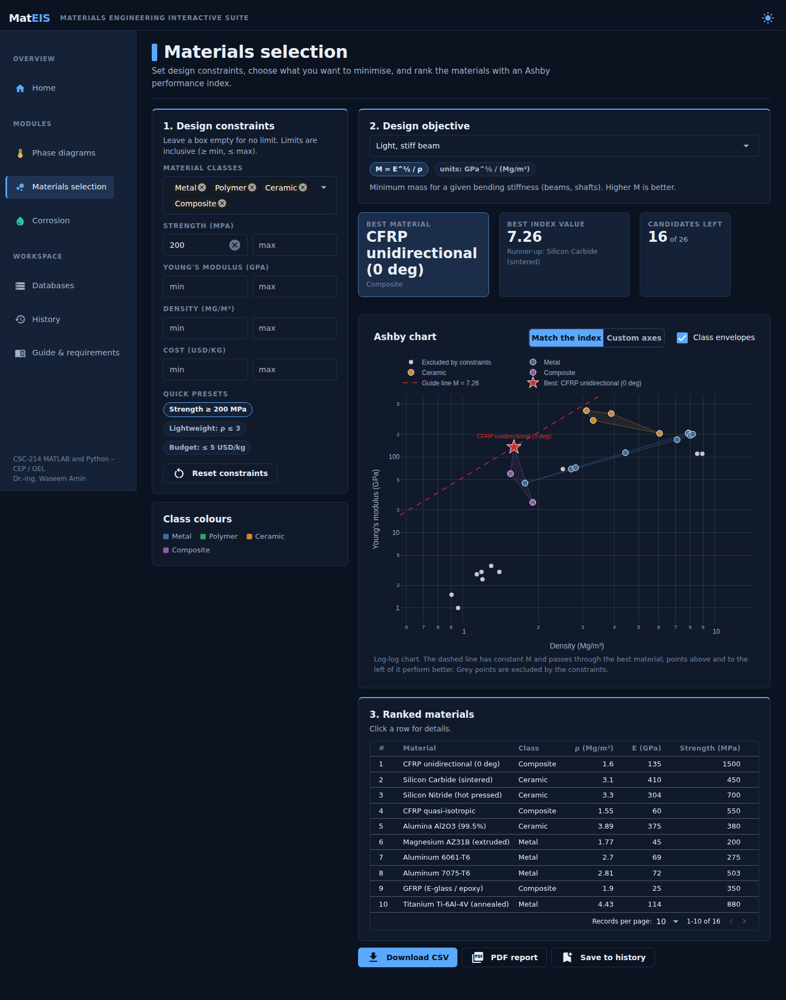
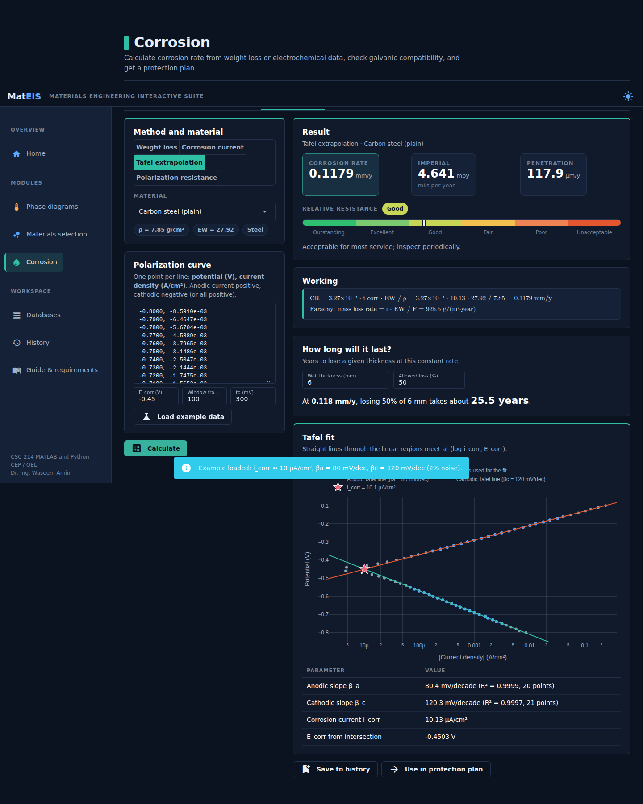

# MatEIS – Materials Engineering Interactive Suite

## Project context

The academic details below describe the project brief, rather than my degree affiliation. I study BS Computer Science at COMSATS University Islamabad, Lahore Campus.

**Course brief:** CSC-214 MATLAB and Python – CEP / OEL · **Instructor named in the brief:** Dr.-Ing. Waseem Amin
**Programme named in the brief:** B.Sc. Metallurgy & Materials Engineering, University of the Punjab, Lahore

MatEIS is one web application that implements **all three** project themes, each with its own module:

| Module | Theme | What it does |
|---|---|---|
| **Phase diagrams** | 1 – Phase Diagram Interactive Simulator | Fe–Fe₃C, Cu–Ni and Pb–Sn diagrams. Enter composition and temperature (or click the diagram) to get the phases present, their compositions and amounts by the **lever rule**, and the predicted **microstructure** (e.g. proeutectoid ferrite vs pearlite) with a schematic micrograph. |
| **Materials selection** | 2 – Materials Selection & Ashby Plotter | 26 materials, constraint filters (e.g. strength ≥ 200 MPa), 9 Ashby **performance indices**, an interactive log-log Ashby chart with a guide line and the optimal material highlighted. |
| **Corrosion** | 3 – Corrosion Rate & Kinetics Calculator | Corrosion rate in mm/y and mpy from **weight loss**, **i_corr**, **Tafel extrapolation** or **polarization resistance**; **galvanic risk** from an editable **EMF series** database; a **protection plan** (coatings, sacrificial anodes, anode sizing) and a PDF report. |






## Technology

| Layer | Choice | Why |
|---|---|---|
| Language | Python 3.11+ | Required by the project |
| UI | **NiceGUI** (Python-only web GUI on FastAPI, Quasar components) | A rich, modern interface written entirely in Python, as the document requires |
| Charts | **Plotly** (interactive) and **matplotlib** (embedded view, PNG and PDF reports) | Click-to-select diagrams, log-log Ashby charts; matplotlib as in the project text |
| Numerics | numpy, pandas | Data handling and calculations |
| Storage | **SQLite** (`sqlite3`), seeded from JSON | Materials, EMF series, history |
| Tests | pytest, pytest-asyncio, NiceGUI user simulation | 460+ tests incl. boundary values and UI flows |
| Quality | ruff, GitHub Actions CI | Linting and CI configuration |
| Hosting | Docker on Render or Hugging Face Spaces | See `docs/DEPLOYMENT.md` |

## Install and run

Requires Python 3.11 or newer.

```bash
git clone https://github.com/mtaimoor1407/MatEIS-Suite.git
cd MatEIS-Suite
python -m venv .venv
.venv\Scripts\activate            # Windows  (macOS/Linux: source .venv/bin/activate)
pip install -r requirements.txt
python main.py                     # then open http://localhost:8080
```
The database `data/mateis.db` is created and filled automatically on the first start.

## Run the tests

```bash
pip install -r requirements-dev.txt
pytest -q          # 460+ tests, about 10 seconds
ruff check .       # style and lint
```

## Project structure

```
main.py                       Entry point (registers pages, starts the server)
config.py                     Course info, team, file paths
core/                         Science and data logic. No UI code.
  exceptions.py               Custom exceptions
  storage.py                  HistoryStore (saved analyses, SQLite)
  phase/                      THEME 1
    diagram.py                PhaseDiagram: regions, tie-lines, lever rule
    diagrams.py               Fe–Fe₃C, Cu–Ni, Pb–Sn definitions
    microstructure.py         Microconstituents (pearlite, ledeburite, eutectic …)
    schematic.py              Schematic micrograph (numpy + matplotlib)
    plotting.py               matplotlib diagram
  selection/                  THEME 2
    material.py, database.py, filters.py, indices.py, properties.py, report.py
  corrosion/                  THEME 3
    rates.py                  weight loss, i_corr, Tafel fit, Stern–Geary
    emf.py                    EMF / galvanic series DB + risk assessment
    protection.py             recommendations + sacrificial-anode sizing
    materials.py              equivalent weight and density
  reporting/                  PDF reports (matplotlib PdfPages)
ui/                           NiceGUI interface
  layout.py, services.py, static/theme.css
  pages/                      home, phase, selection, corrosion, data, history, guide
  components/, figures/       reusable widgets, Plotly/SVG figures
data/                         materials_seed.json, emf_series.json (SQLite file created at run time)
tests/                        pytest suite
docs/                         guides, traceability, scripts, screenshots
```

## The science in brief

* **Lever rule.** In a two-phase field draw the horizontal tie-line at temperature T. With boundary compositions C_α and C_β: W_α = (C_β − C₀)/(C_β − C_α), W_β = (C₀ − C_α)/(C_β − C_α).
  The code finds the tie-line by intersecting the phase-field polygon with the line T = const.
* **Microstructure of steel below 727 °C.** Hypoeutectoid: W_pearlite = (C₀ − 0.022)/0.738, W_proeutectoid α = (0.76 − C₀)/0.738. Hypereutectoid: W_pearlite = (6.70 − C₁)/5.94, W_proeutectoid Fe₃C = (C₁ − 0.76)/5.94.
* **Ashby indices.** M = E^½/ρ (stiff beam), σy^⅔/ρ (strong beam) and others; replacing ρ by cost per volume gives the cheapest material. Lines of constant M have slope 1/p on log–log axes.
* **Corrosion.** CR[mm/y] = 8.76×10⁴ ΔW/(A t ρ) (ASTM G1); CR = 3.27×10⁻³ i_corr EW/ρ (Faraday, ASTM G102); Tafel lines fitted on both branches intersect at (log i_corr, E_corr); i_corr = B/R_p (Stern–Geary).

## Data sources and honesty about accuracy

Material values are typical room-temperature figures (Callister & Rethwisch App. B, MatWeb, Ashby) and each row has a source and a *verified* flag. Phase diagrams are digitised piece-wise linear approximations (about ±10 °C, ±1 wt%) tuned so the textbook worked examples reproduce exactly. The seawater galvanic series gives typical mid-range values. `docs/DATA_VERIFICATION.md` is the sheet your team signs. The commercial Ashby (CES) database is proprietary and was not copied.

## Limitations

* Equilibrium (slow-cooling) assumptions; no kinetics, TTT or alloying elements beyond the binary systems.
* Ashby indices ignore toughness, fatigue, corrosion, temperature and manufacturability.
* Corrosion rates assume uniform attack; pitting, crevice and stress-corrosion cracking are not predicted.
* Protection advice is a screening aid, not a specification.
* On free hosting the disk is temporary: edits made online are lost on restart (the seed data returns).

See `docs/` for the user guide, architecture, requirement traceability, presentation outline, video script and deployment guide.
