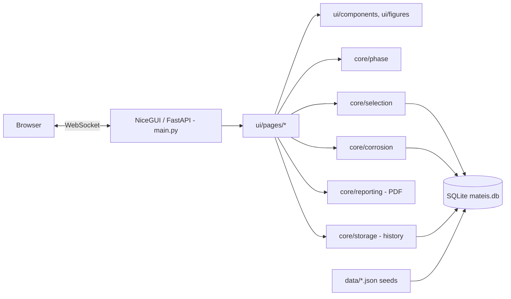

# Architecture

## Layers

**Rule:** `core/` never imports NiceGUI. All science and data logic can therefore be tested without a browser and reused in a script or notebook.

## Theme 1 – phase diagrams (`core/phase`)
A diagram is a **tiling** of the composition–temperature rectangle by polygons, one per phase field (`Region`). One idea gives every result:
* *which field?* point-in-polygon (`point_in_polygon`)
* *tie-line?* intersect the field with `T = const` (`horizontal_crossings`), leftmost and rightmost crossings are the boundary compositions
* *amounts?* lever rule on those two compositions (`PhaseDiagram.equilibrium`)
Invariant lines (`Invariant`) are handled explicitly: a point exactly on the line is evaluated just below it and the app says so.
`microstructure.py` converts phases into **microconstituents** (pearlite, proeutectoid ferrite, ledeburite, eutectic) using the textbook formulas. `schematic.py` draws a Voronoi grain mosaic whose area fractions follow the mass fractions.
The test suite proves the tiling is exact (polygon areas sum to the rectangle; random points fall in exactly one field), that lever fractions sum to 1 and balance mass, and that textbook examples reproduce.

## Theme 2 – selection (`core/selection`)
`Material` (frozen, validated dataclass) → `MaterialDatabase` (SQLite CRUD, seed) → `Constraints` / `apply_constraints` → `PerformanceIndex` / `rank_materials` → `report` (CSV, PDF). Index M = Yᵖ/X (Y = E or σy, X = ρ or cost per volume); the guide line is y = y₀ (x/x₀)^(1/p).

## Theme 3 – corrosion (`core/corrosion`)
* `rates.py`: weight-loss, Faraday i_corr, Tafel fit (linear regression of E vs log|i| on both branches, intersection), Stern–Geary, service life.
* `materials.py`: equivalent weight EW = 1/Σ(n f / W) (ASTM G102).
* `emf.py`: `EMFDatabase` (two series, CRUD) and `assess_couple` (score = ΔE/0.15 + environment factor + log₁₀ area ratio).
* `protection.py`: rule base → `Recommendation` list; `size_anodes` (I = A f i; mass = I t 8766 / (capacity u)).

## UI (`ui/`)
`layout.frame()` builds header, navigation and dark-mode toggle. Each page is one function with local state; widgets call `core/` and render results. Reusable pieces live in `components/kit.py` (panel, metric, stacked bar, rating scale, notices) and `figures/` (Plotly figures, SVG illustrations generated from real data). Design tokens are CSS variables in `static/theme.css`; each module owns one accent colour: heat (phase), steel (selection), verdigris (corrosion).

## Units
Ashby convention: ρ in Mg/m³, E in GPa, σ in MPa, cost in USD/kg, cost per volume in USD/L. SI density (kg/m³) is stored in the database and converted once in `Material.to_record()`. Corrosion: g, cm², h, g/cm³, µA/cm², mm/y.

## Error handling
Custom exceptions (`ValidationError`, `DuplicateMaterialError`, `MaterialNotFoundError`, `DatabaseError`) are raised in `core/` and shown as friendly messages in the UI. Database `CHECK` constraints repeat the validation. SQL is always parameterised.

## Testing
463 tests: unit tests per module, boundary values (limits, just-outside values, NaN, ∞, wrong types, negative, min > max, empty results, single material, corners of every diagram), data-integrity tests on the seed files, property-style tests (mass balance, constant M along the guide line), PDF/PNG validity, and end-to-end UI flows with NiceGUI's simulated user.
